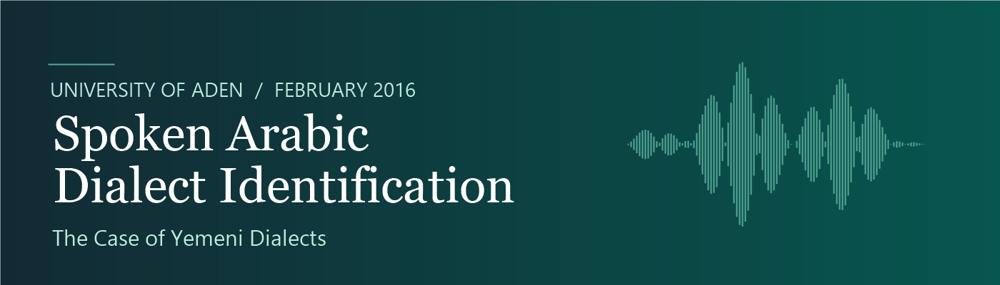
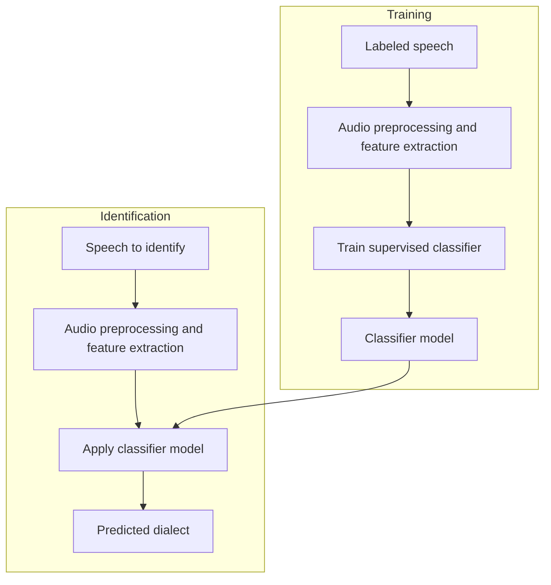
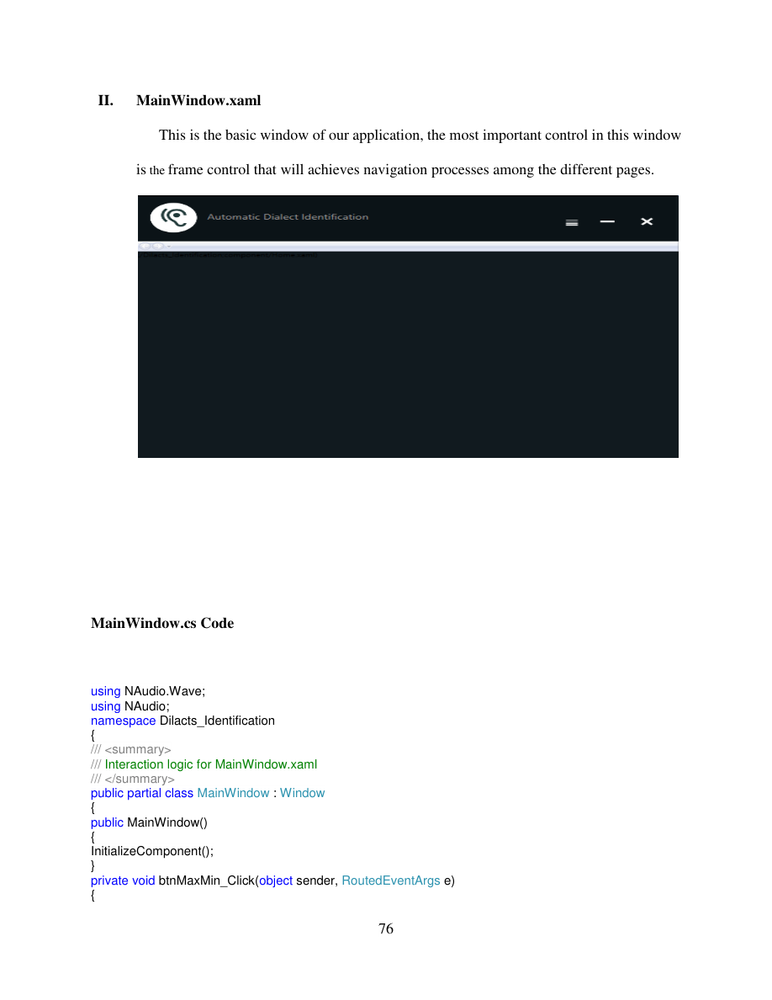
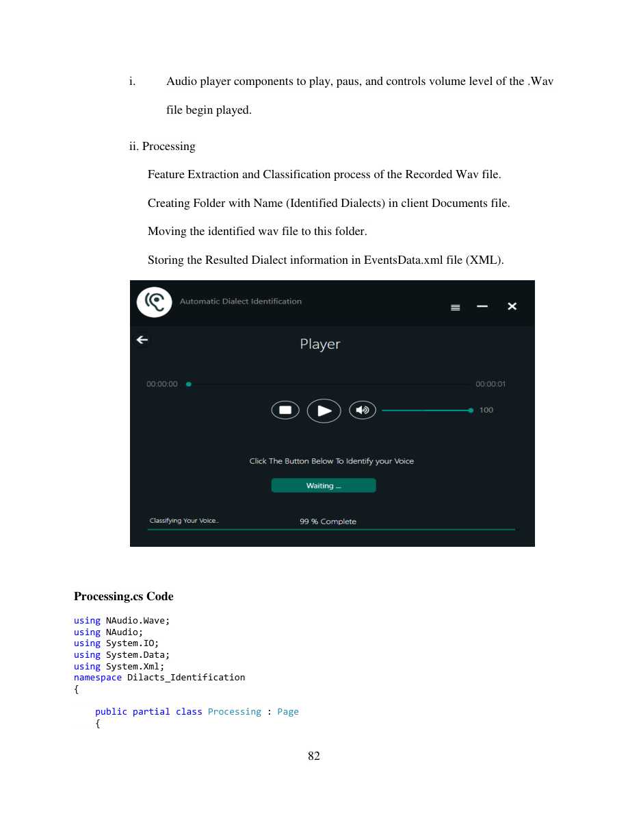
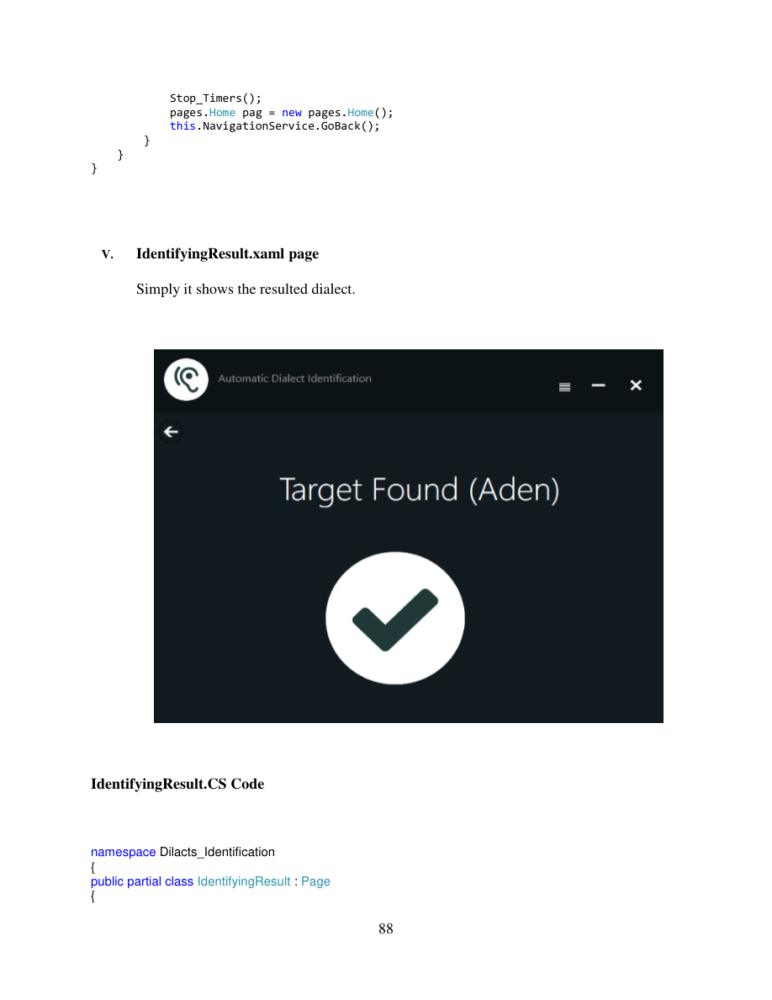

# Spoken Arabic Dialect Identification
## The Case of Yemeni Dialects

**University of Aden · Faculty of Engineering · Department of Computer Science and Engineering · February 2016**

[Complete thesis · PDF, 113 pages](original-2016/docs/Full-Thesis-2016.pdf) · [العربية](README.ar.md) · [Research site source](docs/) · [Archive citation metadata](CITATION.cff)

 · [Zenodo research archive (v1.0.0)](https://doi.org/10.5281/zenodo.24600512)

## Research overview

This graduation project explored whether acoustic features and classical supervised classifiers could distinguish five Yemeni Arabic dialects: Adeni, Dalai, Hadhrami, Lahji, and Sanaani. The team compared pronunciations of the same greeting, السلام عليكم, using mel-frequency cepstral coefficients (MFCCs) and discrete wavelet transforms (Haar and Daubechies 4). The linked thesis PDF includes the corrected front-matter indexes.

## System architecture

Training learns classifier rules from processed, labeled speech. Identification applies those rules to features extracted from an input recording. The original desktop demonstration used C#/WPF, NAudio, compiled MATLAB components, and WEKA via IKVM.NET. [Original classification model, thesis p. 5](original-2016/screenshots/p05-architecture.png)

## Historical experimental results

Selected rows from the archive transcription of thesis Tables 1–7. Both Naive Bayes and SVM reached the highest reported accuracy, **95%**, with DB4 and discretization.

| Thesis table | Configuration | Classifier | Accuracy | ROC AUC |
| --- | --- | --- | ---: | ---: |
| 7 | DB4 discretization | Naive Bayes | 95% | 0.996 |
| 7 | DB4 discretization | SVM | 95% | 0.979 |
| 6 | DB4 Bagging | Bayes Net | 90% | 0.989 |
| 5 | DB4 attribute selection | Bayes Net | 83.75% | 0.971 |
| 2 | MFCC full | Naive Bayes | 70% | 0.857 |

The study accepted 80 of 125 recordings. The accepted corpus was small, imbalanced, male-only, and based on a single phrase. The available artifacts do not establish whether attribute selection and discretization were fitted within each validation fold. The original audio and trained models are unavailable, and the historical results have not been independently reproduced.

[All reported results (CSV)](original-2016/results/reported-results.csv) · [Recording counts](original-2016/dataset/recording-counts.csv) · [Recovery notes and Table 4 correction](original-2016/RECOVERY.md)

## Original application

The images below are page renders from the 2016 thesis.

| Main window (p. 76) | Playback and processing (p. 82) | Identification result (p. 88) |
| --- | --- | --- |
|  |  |  |

[Browse all original figures and screenshots](original-2016/screenshots/)

## Original Research Team — 2016

<table>
  <tr>
    <td align="center" width="33%">
       
      <strong>Ali A. Baowain</strong> 
      <a href="https://github.com/alibaowain">@alibaowain</a> 
      Original researcher
    </td>
    <td align="center" width="33%">
       
      <strong>Mohammed N. Mubark</strong> 
      <a href="https://github.com/mohammednageebmubarak">@mohammednageebmubarak</a> 
      Original researcher
    </td>
    <td align="center" width="33%">
      <strong>Mohammed N. Obaid</strong> 
      Original researcher
    </td>
  </tr>
  <tr>
    <td align="center" width="33%">
      <strong>Ahmed A. Sallam</strong> 
      Original researcher
    </td>
    <td align="center" width="33%">
       
      <strong>Ahmed R. Abdo</strong> 
      <a href="https://github.com/ahmedrashadabdo">@ahmedrashadabdo</a> 
      Original researcher
    </td>
    <td align="center" width="33%">
       
      <strong>Haytham Y. Al-Areaqi</strong> 
      <a href="https://github.com/alHaitham2020">@alHaitham2020</a> 
      Original researcher
    </td>
  </tr>
</table>

**Academic supervisor:** Dr. Ibrahim Nani. All six researchers are listed in the original title-page order.

[Author record](original-2016/AUTHORS.md) · [Citation metadata](original-2016/CITATION.cff)

## Research rights and attribution

The original 2016 research belongs to the six researchers credited on the thesis title page. If you build on its methods or findings, cite the thesis and credit the full research team. For substantial extensions, we welcome contacting the original researchers to discuss possible collaboration. Authorship of new work should reflect each contributor’s actual contribution.

The repository specifies no open-source license. Obtain any permissions required when reproducing or redistributing material.

## Repository guide

- [Original 2016 archive](original-2016/README.md) includes the thesis, partial source transcriptions, historical results, and recovery notes.
- [Reconstructed application](reconstructed/README.md) contains later C#/WPF, MATLAB, and Java/WEKA code based on the thesis. See [validation status](reconstructed/VALIDATION.md) and [reconstruction assumptions](reconstructed/ASSUMPTIONS.md).
