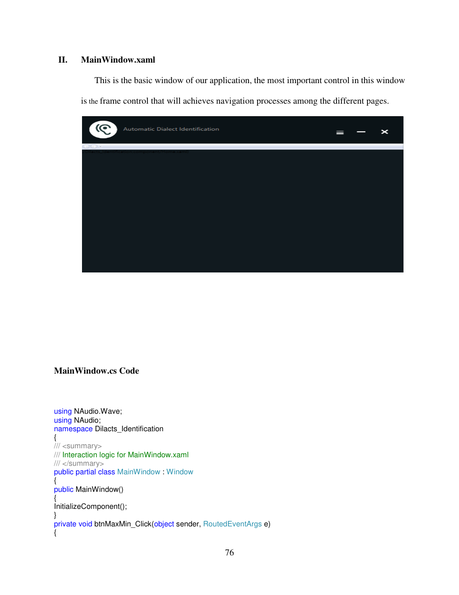

# Spoken Arabic Dialect Identification: The Case of Yemeni Dialects (2016)

**Historical research archive — partial source recovery from the original thesis.**

Bachelor graduation project, Department of Computer Science and Engineering, Faculty of Engineering, University of Aden, February 2016. The project explored automatic classification of five spoken Yemeni Arabic dialects using acoustic feature extraction and classical supervised machine learning.

## Research overview

The team collected 125 recordings, accepted 80 male-voice recordings, and used the common phrase “السلام عليكم” to compare pronunciations. The dialects were Adeni, Hadhrami, Lahji, Sanaani and Dalai. The original methodology compared MFCC and discrete wavelet transforms (Haar and DB4), Naive Bayes, Bayesian networks, SVM and k-nearest neighbours, with feature selection, discretization and ensemble methods. The desktop demonstration used C#/WPF, MATLAB compiled components, WEKA through IKVM.NET, and NAudio.

## Reported results

| Configuration | Classifier | Reported accuracy |
|---|---|---:|
| DB4 + discretization | Naive Bayes | 95% |
| DB4 + discretization | SVM | 95% |
| DB4 + attribute selection + bagging | Bayesian network | 90% |
| DB4 + attribute selection | Bayesian network | 83.75% |
| MFCC, full dataset | Naive Bayes | 70% |

These are historical results reported by the authors, not independently reproduced. The small, imbalanced, male-only, phrase-dependent corpus limits generalization. Whether feature selection/discretization was fitted within each validation fold is not established by the available artifacts.

## Original application

## Archive contents

- `docs/`: [complete thesis with corrected indexes](docs/Full-Thesis-2016.pdf); the original three source PDFs are retained separately offline.
- `src/CSharp/`: eight code transcriptions from pp. 70–91; original page text for comparison.
- `src/MATLAB/`: the documented preprocessing fragment from Figure 5.2.
- `src/Resources/`: XML example transcribed from pp. 92–93.
- `screenshots/`: page renders of original figures, application interfaces and results.
- `dataset/`: aggregate recording counts only; no participant audio or original feature data.
- `results/`: transcribed accuracy and ROC values from Tables 1–7.
- `experiments/`, `dependencies/`: documentation of original methodology and missing dependencies.

## Recovery status

This is **not** a complete original source repository or executable release. The 2016 source tree, Visual Studio project/solution, XAML source, MATLAB feature-extraction functions, compiled libraries, training ARFF files, models, and audio corpus were not supplied. The C# excerpts may contain omissions, PDF extraction errors, or defects present in the printed text. They have not been compiled or executed. No missing original source is fabricated. See [RECOVERY.md](RECOVERY.md) and [INSTALLATION.md](INSTALLATION.md).

## Authors

Ali A. Baowain; Mohammed N. Mubark ([@mohammednageebmubarak](https://github.com/mohammednageebmubarak)); Mohammed N. Obaid; Ahmed A. Sallam; Ahmed R. Abdo; Haytham Y. Al-Areaqi ([@alHaitham2020](https://github.com/alHaitham2020)). Supervisor: Dr. Ibrahim Nani. Names are transcribed from the original title page.

## Research rights and attribution

The original 2016 research belongs to the six researchers credited on the thesis title page. If you build on its methods or findings, cite the thesis and credit the full research team. For substantial extensions, we welcome contacting the original researchers to discuss possible collaboration. Authorship of new work should reflect each contributor’s actual contribution.

The repository specifies no open-source license. Obtain any permissions required when reproducing or redistributing material. [Citation metadata](CITATION.cff) · [Author record](AUTHORS.md)
